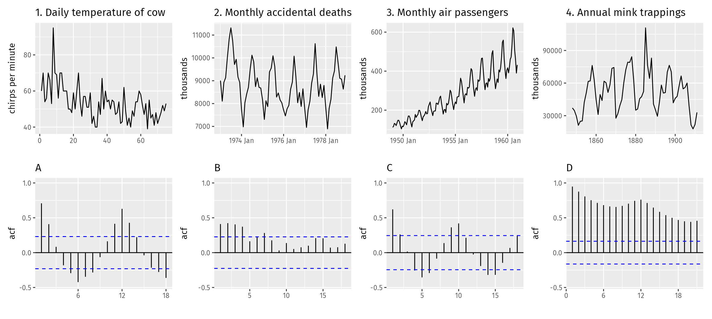

```{r setup, include=FALSE}
knitr::opts_chunk$set(message = FALSE, warning = FALSE, fig.width = 8, fig.height = 4.5)
library(fpp3)
library(USgas)
```

Раздел 2.10. Один и тот же розничный ряд (seed `20260930`) используется в лабах 2, 3, 5, 6 и 7.

```{r}
set.seed(20260930)
retail_id <- sample(aus_retail$`Series ID`, 1)
myseries <- aus_retail |>
  filter(`Series ID` == retail_id)
retail_id
```

## 1. Четыре ряда

```{r}
bricks <- aus_production |> select(Bricks) |> filter(!is.na(Bricks))
lynx <- pelt |> select(Lynx)
close <- gafa_stock |> select(Symbol, Date, Close)
demand <- vic_elec |> select(Demand)

interval(bricks)
interval(lynx)
interval(close)
interval(demand)
```

Кирпич — квартал, рысь — год, цены закрытия — день (торговые дни, индекс нерегулярный), спрос Victoria — полчаса.

```{r}
autoplot(bricks, Bricks)
autoplot(lynx, Lynx)
autoplot(close, Close)
autoplot(demand, Demand) +
  labs(title = "Получасовой спрос на электроэнергию, Victoria",
       y = "Спрос, МВт", x = "Время")
```

## 2. День максимума цены закрытия

```{r}
gafa_stock |>
  group_by(Symbol) |>
  filter(Close == max(Close)) |>
  select(Symbol, Date, Close) |>
  arrange(Symbol)
```

## 3. tute1.csv

```{r}
tute1 <- readr::read_csv("data/tute1.csv")
mytimeseries <- tute1 |>
  mutate(Quarter = yearquarter(Quarter)) |>
  as_tsibble(index = Quarter)
mytimeseries
```

```{r}
long <- mytimeseries |>
  pivot_longer(-Quarter, names_to = "series", values_to = "value")
long |>
  ggplot(aes(Quarter, value, colour = series)) +
  geom_line() +
  facet_grid(series ~ ., scales = "free_y") +
  labs(title = "Три квартальных ряда, отдельные панели")
long |>
  ggplot(aes(Quarter, value, colour = series)) +
  geom_line() +
  labs(title = "Те же ряды на одной панели")
```

Без `facet_grid` GDP и бюджет рекламы прижимаются к нулю: у Sales другой масштаб.

## 4. Газ Новой Англии

```{r}
new_england <- c("Maine", "Vermont", "New Hampshire",
                 "Massachusetts", "Connecticut", "Rhode Island")
us_total |>
  as_tsibble(index = year, key = state) |>
  filter(state %in% new_england) |>
  autoplot(y) +
  labs(title = "Потребление природного газа, Новая Англия",
       y = "Потребление", x = "Год")
```

## 5. tourism.xlsx

```{r}
tourism_xl <- readxl::read_excel("data/tourism.xlsx") |>
  mutate(Quarter = yearquarter(Quarter)) |>
  as_tsibble(index = Quarter, key = c(Region, State, Purpose))
all.equal(as_tibble(tourism_xl), as_tibble(tourism), check.attributes = FALSE)
```

```{r}
tourism_xl |>
  as_tibble() |>
  group_by(Region, Purpose) |>
  summarise(avg_trips = mean(Trips), .groups = "drop") |>
  slice_max(avg_trips, n = 1)
```

```{r}
tourism_state <- tourism_xl |>
  index_by(Quarter) |>
  group_by(State) |>
  summarise(Trips = sum(Trips)) |>
  ungroup()
tourism_state
autoplot(tourism_state, Trips)
```

## 6. Прибытия в Австралию

```{r}
autoplot(aus_arrivals, Arrivals)
gg_season(aus_arrivals, Arrivals)
gg_subseries(aus_arrivals, Arrivals)
```

У Японии виден подъём и спад, у Новой Зеландии — более ровный рост. Сезонность есть у всех четырёх: пик обычно в определённом квартале. Резкие провалы отдельных кварталов выделяются на графике подсерий.

## 7. Одна розничная серия

```{r}
autoplot(myseries, Turnover)
gg_season(myseries, Turnover)
gg_subseries(myseries, Turnover)
gg_lag(myseries, Turnover, geom = "point")
myseries |> ACF(Turnover) |> autoplot()
```

Есть годовая сезонность (пики ACF на лагах 12, 24) и долгий тренд: ACF затухает медленно. Отдельного бизнес-цикла на этих графиках не видно, сезонная амплитуда со временем растёт.

## 8. Ещё пять рядов

```{r}
private <- us_employment |> filter(Title == "Total Private")
h02 <- PBS |>
  filter(ATC2 == "H02") |>
  index_by(Month) |>
  summarise(Cost = sum(Cost))
hare <- pelt |> select(Hare)

explore <- function(data, y) {
  y <- enquo(y)
  print(autoplot(data, !!y))
  tryCatch(print(gg_season(data, !!y)),
           error = function(e) message("gg_season пропущен: ряд без сезонного периода"))
  tryCatch(print(gg_subseries(data, !!y)),
           error = function(e) message("gg_subseries пропущен: ряд без сезонного периода"))
  print(gg_lag(data, !!y, geom = "point"))
  print(data |> ACF(!!y) |> autoplot())
}
explore(private, Employed)
explore(bricks, Bricks)
explore(hare, Hare)
explore(h02, Cost)
explore(us_gasoline, Barrels)
```

Занятость и бензин растут и имеют год сезона. Кирпич — квартальная сезонность и обрыв ряда около 2005 года. Заяц — многолетний цикл около 10 лет, не календарный сезон. Расходы H02 растут, сезон есть, отдельные месяцы выбиваются.

## 9. Какой график к какой ACF

```{r}

```

Сопоставление по форме, слева направо:

- ряд 1, шум без тренда и сезона — ACF C: корреляции быстро входят в границы;
- ряд 2, устойчивый сезонный рисунок — ACF A: пики на сезонных лагах и почти ноль между ними;
- ряд 3, тренд вместе с сезоном — ACF D: медленное затухание и сезонные пики;
- ряд 4, длинный цикл — ACF B: колебания затухают, но это не гребёнка лага 12.

Медленный спад ACF означает тренд или длинный цикл. Пики через фиксированный лаг означают сезон. Быстрый обрыв означает слабую память.

## 10. Свиньи, Victoria, 1990–1995

```{r}
pigs_short <- aus_livestock |>
  filter(Animal == "Pigs", State == "Victoria",
         year(Month) >= 1990, year(Month) <= 1995)
autoplot(pigs_short, Count)
pigs_short |> ACF(Count) |> autoplot()

pigs_all <- aus_livestock |>
  filter(Animal == "Pigs", State == "Victoria")
pigs_all |> ACF(Count) |> autoplot()
```

Это не белый шум: ACF не обрывается после лага 0, видна сезонность. На длинном ряде границы уже (они порядка \(1/\sqrt{T}\)), сезонные пики читаются увереннее.

## 11. Изменения цены Google

Индекс `Date` пропускает выходные и праздники, поэтому разность по календарю — не «вчерашний торговый день». Индекс заменяется номером торгового дня, и `difference()` считает изменение от предыдущей сессии.

```{r}
dgoog <- gafa_stock |>
  filter(Symbol == "GOOG", year(Date) >= 2018) |>
  mutate(trading_day = row_number()) |>
  update_tsibble(index = trading_day, regular = TRUE) |>
  mutate(diff = difference(Close))
autoplot(dgoog, diff)
dgoog |> ACF(diff) |> autoplot()
```

Изменения похожи на белый шум: почти все корреляции внутри границ. Небольшой выброс отдельных лагов для конечной выборки нормален.
